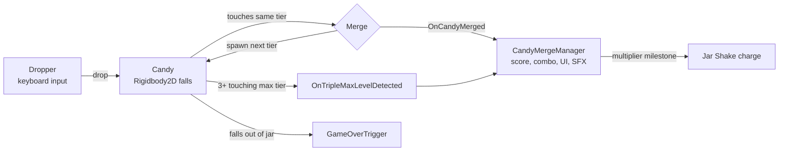

<div align="center">

# 🍬 Candy Merge

### A small 2D physics-based merge puzzle game, built solo in Unity


*Drop candies, merge matching pairs, chain combos, and keep them all inside the jar.*

</div>

---

## 📌 About

**Candy Merge** is a Suika / Watermelon-Game-style puzzle game. I built it on my own as a hands-on project to learn the fundamentals of Unity: 2D physics, keyboard input, audio, UI, coroutines, events, and Shader Graph.

It is a single-scene game with a complete core loop: spawn, drop, merge, score, combo, and a "shake the jar" power-up.

| | |
|---|---|
| 👤 **Role** | Solo developer (gameplay programming, physics tuning, UI, audio integration, shader) |
| 🎮 **Engine** | Unity 6 (6000.3.1f1) |
| 🖌️ **Rendering** | Universal Render Pipeline, 2D Renderer, Global Light 2D |
| 🧱 **Scope** | 1 scene, 7 C# scripts, 7 candy prefabs, 1 custom shader |
| 🖥️ **Platform** | PC (keyboard) |

<!--
📸 Add screenshots / a GIF here, for example:
<p align="center"></p>
-->

---

## ✨ Features

- 🍭 **7 candy tiers** with their own sprite, size, mass, and physics material
- 🧲 **Merge system**: two touching candies of the same tier become one of the next tier
- 🔥 **Combo system** with a time window, a draining combo bar, and an increasing score multiplier
- 💥 **Triple-max rule**: 3 or more connected top-tier candies clear together for a big bonus
- 🫙 **Jar Shake power-up**: earn charges from combos and jostle the jar to free stuck candies
- 🎲 **Weighted random spawning**, so low tiers are common and high tiers are rare
- 🔊 **Layered audio**: looping music, SFX for spawn, drop, impact, and merge, and escalating combo sounds
- 🌄 **Scrolling background** made with a custom Shader Graph
- ⏸️ **Pause menu** using `Time.timeScale`

---

## 🎮 How to Play

### Controls

| Key | Action |
|:---:|---|
| <kbd>A</kbd> / <kbd>D</kbd> | Move the dropper left / right |
| <kbd>Q</kbd> / <kbd>E</kbd> | Rotate the dropper (and the candy it holds) |
| <kbd>Space</kbd> or <kbd>S</kbd> | Drop the candy |
| <kbd>Enter</kbd> | Shake the jar (needs a charge) |
| <kbd>Esc</kbd> | Pause / resume |

### Rules

1. 🍬 Drop candies into the jar.
2. 🔗 Two candies of the **same tier** that touch merge into **one candy of the next tier**.
3. ⏱️ Every merge refreshes the **combo timer** and raises the **score multiplier**.
4. 🫙 Reach **x2, x3, x4...** to earn **Jar Shake charges** (max 5).
5. 🌟 Tier 7 cannot merge further, but **3+ touching Tier 7 candies** clear together for a huge bonus.
6. ❌ If a candy falls out of the jar and hits the game-over line, the run ends.

### 🎲 Spawn probabilities

| Tier | C1 | C2 | C3 | C4 | C5 | C6 | C7 |
|:---:|:---:|:---:|:---:|:---:|:---:|:---:|:---:|
| **Chance** | 50% | 25% | 13% | 7% | 4% | 1% | merge only |

### 🏆 Scoring

```text
Merge score  = ceil( newTier x 10 x comboMultiplier )
Combo step   = +0.1 multiplier per merge (window refreshes on each merge)
Triple-max   = ceil( 7 x 100 x comboMultiplier x candyCount )   and   +1.0 multiplier
```

---

## 🧠 Skills Demonstrated

### ⚙️ 2D Physics (Box2D)
- `Rigidbody2D` in **Dynamic** and **Kinematic** modes: the held candy is kinematic and becomes dynamic on release
- Tuned `mass`, `gravityScale` (heavier tiers fall faster), and damping
- **Continuous collision detection** to stop fast candies tunnelling through each other
- **Physics Material 2D**: `CandyMaterial` (no bounce) and `JellyMaterial` (bouncy) for different candy feels
- `CircleCollider2D`, `PolygonCollider2D` (fitted to sprite outlines), and `BoxCollider2D` triggers
- Two colliders per candy: a solid one for physics and a slightly larger trigger for merge detection
- Tuned Physics2D solver iterations for stable stacking
- A jar built from a frozen `Rigidbody2D`, moved with `MovePosition` during shakes

### ⌨️ Input
- Keyboard handling through `Input.GetKey` and `Input.GetKeyDown`
- Frame-rate independent movement and rotation using `Time.deltaTime`
- Cooldown between drops
- Input System package installed and used for the UI `EventSystem`

### 🔊 Audio
- `AudioManager` **singleton** with `DontDestroyOnLoad`
- Separate `AudioSource`s for music (looping) and SFX, with different volumes
- `PlayOneShot` for overlapping SFX
- Combo SFX that escalate with the multiplier
- Impact SFX gated by fall velocity, so resting candies stay quiet

### 🎨 Visuals, Shader & UI
- **Shader Graph** scrolling background (details below)
- **TextMeshPro** score, floating "+points" popup, and multiplier text
- **Combo bar** driven by `Image.fillAmount`
- Responsive `Canvas Scaler` (reference 1920x1080)
- **Sorting Layers** and alpha so the semi-transparent jar draws over the candies like glass
- PSD sprites imported with the **2D PSD Importer**
- **URP 2D** lighting with a Global Light 2D

### 💻 C# and Architecture
- **Observer pattern** with `static event Action`: `Candy` raises events and `CandyMergeManager` reacts, with no direct coupling. Subscriptions are paired in `OnEnable` / `OnDisable`
- **Coroutines**: timed UI, combo expiry, and a multi-step jar shake (`WaitForFixedUpdate`, `WaitForSeconds`)
- **Prefab workflow**: one prefab per tier, loaded at runtime with `Resources.LoadAll`
- **Weighted random** spawn table
- **BFS graph search** to find clusters of touching top-tier candies
- **Race-condition guard**: only the candy with the lower `InstanceID` performs the merge, so a pair never merges twice
- **Fisher-Yates shuffle** for random shake directions
- Clean Inspector setup with `[Header]`, `[SerializeField]`, and `[RequireComponent]`
- Version control with Git (incremental commits per feature)

---

## 🌄 Shader Spotlight: Moving Background

**File:** `Assets/Resources/Materials/BgScroll.shadergraph` (applied through `BGMat`)

```text
 Time ─────────┐
               ├─► Multiply ─► Tiling And Offset ─► Sample Texture 2D ─► Base Color
 (0.01, 0.01) ─┘               (Offset input)               ▲
                                                       bg5 texture
```

- The UV offset is `Time × (0.01, 0.01)`, so the texture scrolls **diagonally** and endlessly
- The texture uses **Wrap Mode: Repeat**, so the loop is seamless
- It is a lightweight **Unlit** shader with no scripts and no per-frame CPU cost

---

## 🔁 Game Flow



---

## 🗂️ Project Structure

```text
Assets/
├── Resources/
│   ├── Materials/     BgScroll (Shader Graph), BGMat, Physics Materials
│   ├── Music&SFX/     Background music and sound effects
│   ├── Others/        Canvas and Jar prefabs
│   └── Prefab/        Candy1 … Candy7 prefabs
├── Scenes/            Gameplay.unity
├── Script/            C# gameplay scripts
├── Settings/          URP and 2D Renderer settings
└── Sprite/            Candies, jar, background, UI art
```

### 📜 Scripts

| Script | Responsibility |
|---|---|
| 🎯 `Dropper.cs` | Input, movement and rotation, holding and releasing candies, weighted spawning |
| 🍬 `Candy.cs` | Trigger collision, merging, cluster detection (BFS), merge events |
| 🧮 `CandyMergeManager.cs` | Score, combo logic, jar-shake rewards, UI updates |
| 🔊 `AudioManager.cs` | Singleton for music and SFX playback |
| 🫙 `JarFunction.cs` | Jar shake power-up (coroutine and `MovePosition`) |
| 🚧 `GameOverTrigger.cs` | Detects candies leaving the jar |
| ⏸️ `PauseMenu.cs` | Pause and resume with `Time.timeScale` |

### 📦 Key Packages
Universal RP 17.3 · Input System 1.17 · uGUI + TextMeshPro · 2D PSD Importer · 2D Animation

---

## 🚀 Run the Project

1. Install **Unity 6000.3.1f1** (or a compatible Unity 6.3 release) via Unity Hub
2. Clone the repository
   ```bash
   git clone <repository-url>
   ```
3. Open the folder in Unity Hub
4. Open `Assets/Scenes/Gameplay.unity` and press ▶️ **Play**

---

## 🛣️ Roadmap

This is a learning project, and these are the next steps I plan to take:

- [ ] 🏁 Game Over screen, Restart button, and persistent High Score (`PlayerPrefs`)
- [ ] 🖱️ Mouse and touch controls
- [ ] ✨ Particle effects and squash-and-stretch animation on merge
- [ ] 💬 Praise popups ("Good / Great / Awesome / Amazing") for big combos (art already in the project)
- [ ] 👀 Next-candy preview and a Jar Shake charge counter in the HUD
- [ ] ♻️ Object pooling for candies
- [ ] 🎚️ `AudioMixer` with volume sliders
- [ ] 🧩 `ScriptableObject`-based candy configuration (score, spawn weight, sprite)
- [ ] 🏠 Main menu and start screen

### 🔧 Known Limitations
- Restarting the scene does not reset the static `gameOver` flag yet
- The dropper position is not clamped to the jar width
- Candy tier order relies on `Resources.LoadAll` returning prefabs alphabetically. A serialized prefab array would be safer

---

## 🙏 Credits

- **Design, code, and implementation:** PhuNgao (solo project)
- **Music:** background track *"Neo City Dive (From Blue Archive) Lofi"* by VGM Dogg, used for learning and demonstration purposes only. Rights belong to their respective owners
- **Font:** Zorque

---

<div align="center">

**Thanks for checking out Candy Merge! 🍬**

*Built with curiosity, one candy at a time.*

</div>
